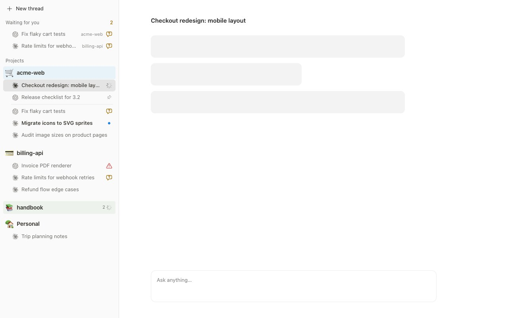

# Threadspace

A Notion-style thread list for [BB](https://getbb.app). It replaces the sidebar thread list with projects, nested threads, project emoji and colours, and quiet status indicators.

[Русская версия](README.ru.md)



## Features

- **Projects as sections.** Each project has an emoji and an optional Notion background colour that fills its row. Icon and colour are chosen in one picker from the project's `···` menu.
- **Pinned threads inside their project.** Pinned threads lead their own project, with a pushpin and a divider, instead of a global favourites list. Pinning uses BB's native pin state.
- **Waiting for you.** Threads where an agent asked a question or needs approval are collected above the projects, with the project name and a count.
- **Quiet statuses.** One column on the right shows a synchronised spinner, a question bubble for input, a warning triangle for errors, or a dot for unread results. A collapsed project or parent thread shows a compact count of work and questions inside it, and nothing when it is idle.
- **Fast feedback.** The pressed thread highlights at once, before BB finishes switching threads.
- **Keyboard.** ↑/↓ move between rows, ←/→ fold and unfold, Enter opens.
- **Drag projects** to reorder them. The order is stored by the plugin and synced between windows.
- **Hover actions.** Pin, archive and the native thread menu appear on hover or keyboard focus. Archiving uses BB's own action, with confirmation and undo.
- **Themes and language.** Follows BB's light or dark theme and background; English and Russian follow the BB interface language.
- **Touch screens.** On phones and coarse pointers the list uses larger rows and always-visible controls.

## Install

```sh
bb plugin install https://github.com/KosachMax/threadspace.git
bb settings ui set sidebar.threadListProvider threadspace/notion-sidebar
```

Switch back to the built-in list:

```sh
bb settings ui set sidebar.threadListProvider thread-list/thread-list
```

## Development

```sh
npm install --include=dev
npm test
npm run typecheck
npm run build
bb plugin install .
```

`screenshots/stand.html` renders the real panel components with demo data for screenshots.

## Credits

Russian emoji names come from [Unicode CLDR](https://cldr.unicode.org/); see `licenses/UNICODE-CLDR.txt`.

## License

MIT
